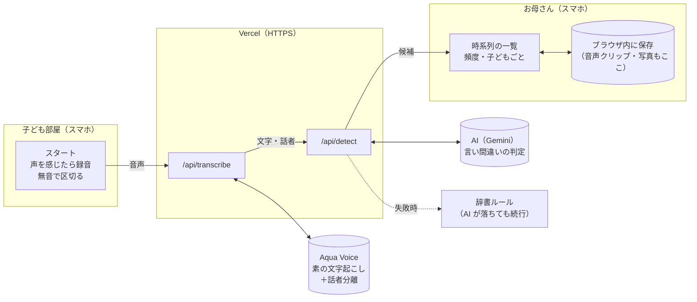

<!--
Qiita 記事の下書き（HACKATHON.md の7項目に沿う）。事実の出典は docs/article-materials.md。
【】は、書き手が埋める所。確認できていないことは断定しない（素材の第0節）。
公開前の点検: AquaVoice と AI HACK が本文に入っている／API キー・個人情報・子どもの実名・絶対パスが入っていない／AI 生成の画像に「AI 生成」と明記した。
この記事は、提出だけでなく、最終プレゼンでも使われる（運営の案内）。画面と動画を載せる。
言語学の話は書き手本人の経験（了解済み）。チームメンバーの家族のコメントを載せるときは、掲載の了解を取る。
タグ案: AIHACK, AquaVoice, 音声入力, ハッカソン, 子育て
-->

# 言い間違い図書館 〜卒業する前に、声で残す〜

> 「てビリ」と言っていたあの子の声を、卒業の日まで、声のまま残しておく。

## 1. 作品名・キャッチコピー

**言い間違い図書館**

子どもの言い間違いが、放っておくだけで自動で集まり、本棚のように並ぶ。あとで声を聞き返しながら、成長の記念として振り返れるアプリです。

AI HACK Special One-Day Hackathon（テーマ「話すだけで誰かの面倒を減らすアプリ」）で、**AquaVoice** を使って作りました。

<!-- 画像: A-2-hero.png（見出し）、A-1-logo.png -->

## 2. 解決したい困りごと

### 誰の、どんな場面か
仕事と家事に追われて、日々に忙殺されているお父さん・お母さん。気づいたら、いつの間にか子どもが「卒業」してしまっていた、という場面です。

### 何が困るのか
- 子どもの言い間違い（例:「テレビ」を「てビリ」、「とうもろこし」を「とうもころし」）は、**数か月で言わなくなる**。
- 忙しい毎日の中で、気づいたときには、もう言わなくなっている。**何を言い間違えていたのかも、思い出せない**。
- 愛おしいわが子の、たくさんの「卒業」を、覚えていない。ハイハイから立った日、一人でご飯を食べられた日と同じで、**卒業の日は、誰も記録していない**。
- **卒業の日は、いつ来るか分からない**。だから、「そのときが来たら書き留める」という手動の記録では、間に合わない。しかも、料理中や抱っこ中は、手でメモもスマホ入力もできない。
- たとえ書き留めても、**あとで振り返るのが大変**。メモ帳、写真、LINE にばらばらに散らばり、「あの言い間違い、いつだっけ」を探し出すだけで一苦労になる。
- 必要なのは、気合いで書き留めることではなく、**気づかないうちに勝手に残り、あとで楽に振り返れること**。

### なぜこの課題を選んだか
- チームの議論では、最初は「ケンカの仲裁」「献立」「家庭内の言った・言わない」など、「面倒を減らす」案をたくさん出しました。
- 最終的に選んだのは、「面倒を減らす」より、**「あとで悔やむことを減らす」**課題です。
- 着想の種は、私の大学時代の記憶です。文学部にいて、今も言語学に興味があるのですが、そこで「**子どもの言い間違いは、言語学的にもとても価値がある。だけど、なかなか残されづらい**」という話を聞いたことがありました。今回のテーマ「お母さんの悩み」と結びついたとき、その話を思い出しました。
- 言語学の世界で価値があるのに残されないのは、**残す側（親）に、記録する余裕がない**からです。だから、親が何もしなくても残る仕組みなら、課題が解決できると考えました。
- 【チームメンバーの家族（お母さん）からもらったコメントを、ここに1〜2文。掲載の了解を取ってから】

## 3. アプリでできること

- **言い間違いの自動収集**: 子ども部屋に置いたスマホが、声を感じたときだけ録音し、言い間違いを見つける。
- **自動で図書館に並ぶ**: 見つけた言い間違いは、確認なしで、時系列（新しい順）に入る。一覧は、柱の背比べのような**木の物差し**で、日付は、物差しに鉛筆でつけた印として並ぶ。スクロールするだけで、成長を振り返れる。
- **新着は「手紙」で届く**: 前に開いてから届いた言い間違いを、**ことば鳥**が、おてがみにして運んでくる。「よんだよ」を押すと、既読になる。
- **声のまま残す**: 文字だけでなく、その子の**声のクリップ**も保存する。「声」ボタンで、本当は何と言ったかを聞き返せる。
- **子どもごとに分ける**: 子どもを最大6人まで登録でき、誰が言ったかで分けて数える。
- **頻度が分かる**: 詳細を開くと、通算、直近7日、1週間あたり、日別の回数が出る。
- **言い間違いは、ことば鳥の卵**: 何度も言うと卵が孵って、育ち、卒業すると虹色の羽で飛び立つ。数を数えるだけの記録でなく、「育てている」実感が出る。
- **録音ファイルから入れる**: 録音アプリで録った声（スマホのボイスメモなど）を選ぶと、文字起こしと判定を通して図書館に入る。見つからないときは、声を聞いて、聞こえたとおりに書いて登録できる。登録した言葉は、次からは Aqua へのヒントになる。
- **あとから人が決める**: 誰が言ったか、正しい言葉（訂正）、卒業した日、写真、図書館から外すかどうか、はお父さん・お母さんが決める。

使うと何が変わるか: 手を止めずに、「気づいたときには消えていた」ことばを、声のまま取り戻せます。

<!-- 画像: S-3-timeline.png、S-4-filter-kid.png、S-5-detail-frequency.png、S-6-detail-edit.png -->

## 4. アプリの使い方

1. 子ども部屋に、古いスマホを置く。子ども側の画面は、大きな **「スタート」** を押すだけ（画面を見ない子どものために、ひらがなで大きく）。
2. 画面に「きいてるよ」が出る。以降は、**手で何も押さない**。
3. 子どもが話すと、声を感じて自動で録音し、無音で区切る。
4. 言い間違いが見つかると、お母さんのスマホに、ことば鳥が「おてがみ」を運んでくる。
5. お母さんは、物差しの一覧を見るだけ。気になった言葉を開くと、頻度が出て、声のクリップを聞き返せる。
6. 必要なときだけ、「だれ?」の選択、訂正、卒業日、写真を入れる。

<!-- 画像: S-1-room-idle.png、S-2-room-listening.png、動画: M-1-flow（GIF） -->

※ 記事の動画・画像は、実機のマイクで録ったものではありません。【動画の作り方に合わせて、どれか1つを書く: 「実際の画面を録画したもの（例のデータ入り）」／「画面の入力欄から文章を送って代用したもの」／「操作のイメージ（実際の画面の録画ではない）」】

## 5. AquaVoice・AI の活用方法

### 全体の構成

### AquaVoice を使う場面
- 区切った音声を、**Aqua Voice の API（素の文字起こし `audio/transcriptions`、`avalon-2`、日本語指定）**に送って、文字にする。
- 複数の話者がいる会話は、**話者分離（`diarize=true`）**で、誰の発話かを分ける。同期 API で使えた。
- 声を感じて録音を始める部分（声検出）は、Aqua でなく、アプリ側で作った。

### AI（Gemini）が処理すること
- 文字起こしした文から、**言い間違い**を判定する。
- 辞書にない言い間違いも見つけた。例: 「らいよん → ライオン」「しんかんしぇん → しんかんせん」。言い間違いのない文や、正しい言葉には、候補を出さなかった。
- AI が止まっても、辞書ルールで続ける（会場の通信が不安定でも、デモが止まらない）。

### なぜキーボードではなく音声なのか
- 手が離せない場面で、入力そのものができない。
- そして、**言い間違いは、文字にした瞬間に消える**。「テレビ」と正しく打てば、「てビリ」は残らない。音声だからこそ、**言い間違いを言い間違いのまま、声ごと残せる**。

### 実際にぶつかった壁（測って分かったこと）
- **整形済みの文字起こしを使うと、言い間違いが直されてしまう恐れがあった。** そのため、素の文字起こしを選んだ。実測では、「てびり」は「手びり」、「とうもころし」は「トウモコロシ」と、**直されずに**出た。
- ただし、**ぶれがあった**。同じ音声を5回ずつ送ると、1本は5回とも「手びり」。もう1本は、5回中2回が「手振り」と、**実在する別の言葉に書き換えられた**。辞書でも AI でも、これは言い間違いと気づけない。
- そこで、**言い間違いの音声クリップそのものを残す**ことにした。お母さんは「声」ボタンで、本当は何と言ったかを確かめられる。**文字起こしが間違っても、「声」という一次情報は消えない**。
- 話者分離の応答は、話者ごとの「ターン」（話者ラベル・開始・終了・文）で返ってくる。話者ラベルは**録音ごと**の番号で、別の録音の同じ子とは限らない。そこで、「誰が言ったか」はお母さんが一覧で選び、同じ録音の同じ声には、まとめて反映する。

## 6. 工夫したこと

- **課題を1つに絞った。** 最初は、ケンカの仲裁、献立、家庭内の「言った・言わない」まで広がっていた。自己審査で 150/300 点と出て、「機能が多すぎる」と指摘され、言い間違い1本に絞った。
- **子ども側は、押すだけ。** 「スタート」と「おわり」の2つだけ。ひらがなで大きく。
- **自動で残し、人があとで決める。** 最初は「確認して収蔵する」だったが、お母さんの負担を減らすため、自動で入れるように変えた。そのうえで、人が決める所は残した。
- **文字にした瞬間に消えるものを残す。** 言い間違いは、文字にすると直されて消える。だから音声クリップを残す。
- **止まらない作り。** AI が落ちても、辞書ルールで動く。会場の通信が不安定でも、デモが止まらない。
- **鍵を守る。** API キーは、環境変数だけに置き、コードにもログにも書かない。
- **保存は手元に。** 音声クリップと写真は、ブラウザの中だけに保存する（サーバーには置かない）。
- **絵本の世界観。** 言い間違いは「ことば鳥」の卵。時系列は、柱の背比べのような物差し。新着は、鳥が運ぶ手紙。画面の言葉は、**ひらがな**を中心にした。**「AI っぽい」角丸の四角いカードをやめ**、背景に直接書く、紙と鉛筆の雰囲気にした。アプリのイラストは、**AI（GPT）で生成したもの**です。

### 正直に書いておくこと
- 文字起こしのために、**音声は Aqua Voice に、判定のために文字は AI に送られます**。「外部に出さない」とは言えません。
- 確認できていないこと:
  - **本物の子どもの声**での文字起こしと話者分離（確認に使ったのは、パソコンの読み上げ音声）。
  - 実機のスマホでの録音（マイクは HTTPS が必要。Vercel に置いて初めて試せる）。【試せたら書き換える】
  - 子どもが2人同時に話す場面で、話者がきれいに分かれるか（機械音声2人は、どちらも同じ話者と判定された）。
  - 写真の追加、2台の端末にまたがる共有。

## 7. 今後の展望

- 実機のスマホ・本物の子どもの声での検証（話者分離の精度、高い声や不明瞭な発音）。
- 2台の端末をまたぐ共有（子どもの端末とお母さんの端末を分ける）。
- ケンカの仲裁（今日は捨てた機能。同じ録音を使い道にできる）。
- ベビーモニターなど、既存の見守りグッズへの組み込み。
- 「卒業」の自動判定（正しい言い方だけが出たら、卒業の候補にする）。
- 写真つきの成長アルバム、身長の線のような「卒業の記録」。

## 開発の紆余曲折

最初は、「ケンカの仲裁」が主役でした。途中で、**「言い間違いの収集こそが課題だ」と気づき、主役を入れ替えました**。名前も、「ことばの博物館」→「言い間違い博物館」→「言い間違い図書館」と変わりました。転換点を3つ紹介します。

### ① 「面倒を減らす」から「悔やむことを減らす」へ
最初のブレストは、献立づくりや、家庭内の「言った・言わない」を判定する「家庭内裁判」、子ども同士のケンカの仲裁など、「お母さんの面倒を減らす」案ばかりでした。どれも筋は通っていますが、機能が広がるばかり。途中で、「卒業の日は誰も記録していない」という悲しさに気づき、課題を**「あとで悔やむことを減らす」**に捉え直しました。ここで、主役が仲裁から言い間違いに入れ替わりました。

### ② 「Aqua をスマホで立ち上げる」という思い込み
当初、チームの全員が、「子ども部屋のスマホで Aqua Voice のアプリを立ち上げる」ものだと思っていました。API の仕様を調べると、Aqua の API は**ファイルを送る方式**で、ストリーミングはありませんでした。そこで、スマホは録音して送るだけ、Aqua を呼ぶのはサーバー側、という構成に整理し直しました。「人気を感じたら自動でオン」も、Aqua でなく、アプリ側の声検出で作りました。

### ③ 自己審査で 150/300 点
作る前に、公式の審査基準で自己採点をかけると、**150/300 点**でした。「機能が多すぎる」「動くものがまだ無い」という指摘です。これで、言い間違い1本に絞り、動く最小のデモを先に作る方向が決まりました。そしてもう1つ。HTTPS でないとブラウザのマイクが使えないという落とし穴も、構成を考える段階で見つけて、Vercel にデプロイする方針にしました。

## 試してみてください

【Vercel にデプロイしたら、ここに URL を貼る】

- 子ども側: `/room.html`　／　お父さん・お母さん側: `/museum.html`（「例を入れる（デモ用）」で、例のデータが入ります）
- デモ版です。話した音声は、文字起こしのために **Aqua Voice** に、文字は判定のために AI に送られます。保存は、お使いのブラウザの中だけです。
- 他の人の声や、個人が特定できる内容は、入れないでください。
- 【公開 URL にするなら、API の利用量の上限をどうするかを決める（誰でも使えると、API の料金がかかる）】

## おわりに

AI HACK を開催してくださった運営の皆さん、AquaVoice の皆さん、ありがとうございました。

#AIHACK #AquaVoice
