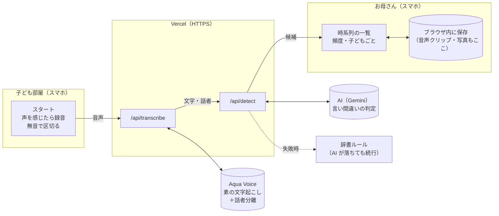

# Qiita 記事の素材（岩田さんへ渡す）

作成: 2026-11-23。記事は岩田さんが書く。ここには**事実・素材・撮るものの一覧**だけを置く。画像・動画は**まだ生成していない**（撮り方と、生成するときの指示だけ用意した）。

**締切**: 14:30 に機能追加を止める → 14:45 に記事を公開して、フォームに提出 → 15:00 締切。

## 0. 先に読む: 書いてよいこと・書いてはいけないこと
**動作を確認した（書いてよい）**
- 「音声 → 文字起こし → 言い間違いの判定」は、API を直接動かして通した（読み上げ音声を使用）。「判定 → 図書館に自動で記録 → 一覧に表示」は、ブラウザの画面で通した（子ども側の画面に文字を入力するデモで確認）
- **ブラウザのマイクで録音して、画面から文字起こしまで通した確認は、まだ無い**（実機・HTTPS が必要）
- 子どもを最大6人登録でき、誰が言ったかで分けて数える
- 一覧は時系列（新しい順）。詳細に頻度（通算・直近7日・1週間あたり・日別）が出る
- 自動テスト30件が通る

**確認できていない（断定しない）**
- 本物の子どもの声は**4本だけ**試した（第3節の表）。話者分離（2人以上の子ども）は、本物の声では未確認
- 実機のスマホでの録音（マイクは HTTPS が必要で、Vercel に置いて初めて試せる）
- 子どもが2人同時に話す場面で、話者がきれいに分かれるか（機械音声2人は、どちらも同じ話者 `spk_0` と判定された）
- 写真の追加、2台の端末にまたがる共有

**書かないこと**: API の鍵、個人名・子どもの実名（デモは「ゆい」「そら」の仮名）。

## 1. 1文で言うと（課題）
子どもの言い間違いは、気づかないうちに「卒業」してしまう。お母さんが手を止めずに、声のまま残して、あとで振り返れるようにする。

- 根拠: ハイハイから立った日と同じ種類のもの。「うわー、取っとけばよかった」と後で思うが、その瞬間はメモできない
- 補強: チームの話者2さんが言語学を専攻していて、子どもの言い間違いは言語学で重要な資料になる（記事に書くときは、本人の了解を取ること）
- 題名の候補（選ぶのは岩田さん）
  1. 「その言い間違い、いつか宝物になる。」
  2. 「話すだけで、子どもの“今”が本棚に並ぶ。」
  3. 「言い間違い図書館 〜卒業する前に、声で残す〜」

## 2. 記事の7項目と、使う素材
| 項目 | 使う事実 | 使う画像 |
| --- | --- | --- |
| ① 作品名・キャッチコピー | 作品名は「言い間違い図書館」。題名は上の候補から | A-1 ロゴ、A-2 見出し画像 |
| ② 困りごと | 1文の課題。誰が（家事や仕事で手が離せないお母さん）・どんな場面（料理中、抱っこ中、診察室）・何に手間がかかる（メモできない） | — |
| ③ できること | 録音は押すだけ。見つけた言い間違いは確認なしで自動で並ぶ。時系列、頻度、子どもごと、写真・訂正・卒業日 | S-3、S-4、S-5 |
| ④ 使い方 | 子ども側は「スタート」を押すだけ。お母さんは一覧を見るだけで、必要なときだけカードを開く | S-1〜S-6 の順 |
| ⑤ Aqua Voice・AI の活用 | 下の第3節 | D-1 構成図 |
| ⑥ 工夫 | 下の第4節 | D-2、S-5 |
| ⑦ 今後 | 下の第5節 | — |

## 3. ⑤ Aqua Voice・AI の活用（事実）
**流れ**
1. 子ども部屋のスマホが、声を感じた時だけ録音し、無音で区切る（声検出はアプリ側。Aqua 側ではない）
2. 区切った音声を、Aqua Voice の**素の文字起こし**（`audio/transcriptions`・`avalon-2`・日本語指定）に送る。話者分離（`diarize`）つき
3. 文字を AI（Gemini）に渡して、言い間違いを判定する（OpenRouter に切り替える作りもあるが、動かして確かめたのは Gemini だけ）
4. 図書館に自動で記録。**保存**はすべてブラウザの中（音声クリップも写真もここに置く）。ただし、文字起こしのために音声は Aqua Voice に、判定のために文字は AI に送られる。記事では「外部に出さない」とは書かず、この点を正直に書く

**本物の子どもの声で測った結果（いちばんの山場）**

チームの子どもの録音4本を、Aqua の素の文字起こしに送った。「ヒントあり」は、図書館に入っている言葉の一覧を `prompt` で渡したもの。

| 子どもが言った言葉 | ヒントなし | ヒントあり | 図書館に入ったか |
| --- | --- | --- | --- |
| さんとさん（サンタさん） | ほんとさ | **さんとさん** | 入った（図書館に「さんとさん」があるとき） |
| て てびり（テレビ） | テレビ | **てびり** | 入った |
| てびりみたい | テレビ、後で見たい。 | **手びり、後で見たい。** | 入った |
| とうもころし | トウモロコシ食べたい。 | とうもろこし食べたい。 | **入らなかった** |

- **Aqua は、知らない言い間違いを、実在する言葉に直す**（さんとさん → ほんとさ、てびり → テレビ）。そのままでは、言い間違いは文字にした瞬間に消える
- **一度覚えた言い間違いは、ヒントで聞こえたまま書き起こせる**。そこで、図書館に入った言葉を、次の録音のヒントとして Aqua に渡す仕組みにした。家族の言い間違いを、使うほど覚えていく
- Gemini も「さんとさん」を言い間違いと判定しなかった（サンタさんのことだと分からない）。だから、図書館の言葉を判定の辞書にも足す
- **限界**: 「とうもころし」は、ヒントがあっても「とうもろこし」に直された。実在の言葉に寄せる力が強いと、ヒントでは防げない
- **1回目は人が登録する**: 見つからなかった録音は、声を聞いて「聞こえたとおり」に書けば図書館に入る（画面の「録音ファイルから入れる」）。次からはヒントになる
- 録音は4本だけ・1人の子どもだけ。一般化はしない

**読み上げ音声で測ったこと（補足）**
- **整形済みの文字起こしを使うと、言い間違いが直されてしまう恐れがあった。** そのため、素の文字起こしを選んだ。実測では、「てびり」は「手びり」、「とうもころし」は「トウモコロシ」と、**直されずに**出た
- ただし**ぶれがあった**。同じ音声を5回ずつ送ると、1本は5回とも「手びり」。もう1本は5回中2回が「手振り」と、**実在する別の言葉に書き換えられた**。辞書でも AI でも、これは言い間違いと気づけない
- 対策として、**言い間違いの音声クリップそのものを残す**。お母さんは「声」ボタンで、本当は何と言ったか確かめられる
- 話者分離は、同期 API で使える（`diarize=true` と `diarized_json`）。応答は話者ごとの「ターン」（話者ラベル・開始・終了・文）で返る。話者ラベルは**録音ごと**の番号で、別の録音の同じ子とは限らない。そこで「誰が言ったか」は、お母さんが一覧で選び、同じ録音の同じ声にはまとめて反映する
- AI は、辞書にない言い間違いも見つけた。例: 「らいよん → ライオン」「しんかんしぇん → しんかんせん」。言い間違いのない文や、正しい言葉には、候補を出さなかった
- AI が止まっても、辞書ルールで続ける（会場の通信が不安定でも、デモが止まらない）

**人が介在するところ**
- 最初は「確認して収蔵する」だったが、**お母さんの負担を減らすため、自動で入れる**ように変えた（記事の「工夫」「紆余曲折」に使える）
- そのうえで、人が決める所を残した: 誰が言ったか／正しい言葉（訂正）／卒業した日／写真／図書館から外す。声を聞いて確かめる

## 4. ⑥ 工夫したこと
- **課題を1つに絞った。** 最初は、ケンカの仲裁、献立、家庭内の「言った・言わない」まで広がっていた。自己審査で 150/300 点と出て、「機能が多すぎる」と指摘され、言い間違い1本に絞った（`JOURNEY.md` に時系列がある）
- **子ども側は、押すだけ。** スタートとおわりの2つだけ。画面を見ない子どものために、ひらがなで大きく
- **お母さん側は、文字ベースの時系列。** 新着が上に届く。訂正は一覧に出さず、詳細で入れる
- **文字にした瞬間に消えるものを残す。** 言い間違いは、文字にすると正しい言葉に直されて消える。だから音声クリップを残す
- **止まらない作り。** AI が落ちても辞書ルールで動く。鍵が無くても、台本のデモで通せる
- **鍵を守る。** 鍵は環境変数だけに置く。コードにもログにも書かない
- **保存は手元に。** 音声クリップと写真は、ブラウザの中だけに保存する（サーバーには置かない）

## 5. ⑦ 今後
- 実機のスマホ・本物の子どもの声での検証（話者分離の精度、高い声や不明瞭な発音）
- 2台の端末をまたぐ共有（子どもの端末とお母さんの端末を分ける）
- ケンカの仲裁（今日は捨てた機能。同じ録音を使い道にできる）
- ベビーモニターなど、既存の見守りグッズへの組み込み
- 「卒業」の自動判定（正しい言い方だけが出たら、卒業の候補にする。判定の関数は作ってあるが、画面にはまだ出していない）
- 写真つきの成長アルバム、身長の線のような「卒業の記録」

## 6. 撮る・作るもの（まだ生成していない）
置き場所: `docs/article/assets/`。**ファイル名はこのとおりに**付ける（記事から参照しやすくするため）。

### スクリーンショット（動いている証拠。いちばん大事）
撮り方: ブラウザの開発者ツールで幅 375px（スマホ）にする。お母さん側は、画面の「例を入れる（デモ用）」を押すと、子ども2人（ゆい・そら）と記録が入る。

| ファイル名 | 何を撮るか | 手順 |
| --- | --- | --- |
| `S-1-room-idle.png` | 子ども側。大きな「スタート」 | `/room.html` を開く |
| `S-2-room-listening.png` | 子ども側。「おわり」と「きいてるよ」 | スタートを押した直後（HTTPS か localhost でマイクを許可） |
| `S-3-timeline.png` | お母さん側。時系列の一覧 | `/museum.html` →「例を入れる」 |
| `S-4-filter-kid.png` | 子どもで絞り込んだ一覧 | 「ゆい」のチップを押す |
| `S-5-detail-frequency.png` | 詳細。頻度と聞いた記録 | 一覧の「とうもころし」をタップ |
| `S-6-detail-edit.png` | 詳細の下半分。写真・訂正・卒業日 | 同じ詳細を下へスクロール |
| `S-7-kids-settings.png` | 子どもの情報の入力 | 「子どもの情報」を押す |
| `S-8-who-picker.png` | 「だれ?」の選択 | 「だれ?」を押す |

### 動画・GIF（「動いてる」を見せる）
- `M-1-flow.mp4`（または GIF、15〜20秒）: スタート → 話す → 一覧に新着が出る → 詳細を開く。**実際のマイクで撮れない場合は、`/room.html?demo=1` の入力欄から送って代用する**（その場合は、記事に「デモ入力」と書く）
- `M-2-listen-clip.mp4`（5秒）: 「声」ボタンで、本当の発音を聞き返す場面。これが作品の核

### 図（アーキテクチャ）
- `D-1-architecture.png`: 構成図。**下の Mermaid をそのまま Qiita に貼れる**（Qiita は ` ```mermaid ` に対応）。画像にするなら、これを元に描く
- 公開済みの設計ページ（図解）は、まだ旧名「博物館」と「Claude」の表記のまま。**使う前に更新が必要**
- `D-2-journey.png`（任意）: 「機能を足す → 絞る」の変遷。元は `JOURNEY.md`



### プロモーション素材（生成は後。指示だけ用意）
| ファイル名 | 用途 | 仕様 |
| --- | --- | --- |
| `A-1-logo.png` | 作品のロゴ | 正方形・透過背景。本棚と吹き出しを組み合わせたやさしい印象 |
| `A-2-hero.png` | 記事の見出し画像（OGP） | 1200×630。題名の文字を入れる余白を残す |
| `A-3-sns.png` | SNS 用 | 1080×1080。キャッチと、スマホ画面 S-3 を並べる |

**画像を生成するときの指示（そのまま使える）**
- ロゴ: 「子どもの言い間違いを集める図書館。小さな本棚と吹き出しのロゴ。やさしい水彩風。緑がかった青と珊瑚色。文字なし。正方形、背景透明」
- 見出し画像: 「やわらかい水彩の絵本風。夜のリビングで、お母さんが本棚から1冊を取り出すと、吹き出しの中に子どもの声が入っている。横長1200×630、左側に文字を置く余白」
- 注意: 子どもの顔や実在の人物は描かない。AI で生成した画像は、記事に「AI 生成」と明記する。

**SNS の投稿文（枠だけ。仕上げは岩田さん）**
> 「てびり」「とうもころし」。子どもの言い間違いは、ある日ふっと消えます。話すだけで残る「言い間違い図書館」を #AIHACK で作りました。Aqua Voice の素の文字起こしを使うと、直されずに残る。ただし、たまに別の言葉に化ける。そこで音声クリップごと残しました。記事: {記事のURL}

## 7. 記事に必ず入れるもの（運営の指定）
- Aqua Voice と、AI HACK（イベント名）に触れる
- 記事のリンクを、フォームで送る（15:00 まで）
- 公開前の点検: 鍵・個人情報が入っていない／子どもの顔や実名が入っていない／確認できていないことを断定していない（第0節）

## 8. 渡す人の担当（案）
| 担当 | やること |
| --- | --- |
| 麻生 | スクリーンショットと動画の撮影、構成図の更新、デプロイ（実機での確認） |
| 岩田 | 記事の執筆、題名の選択、画像の生成（作るなら）、公開と提出 |
| どちらか | 本物の子どもの声での確認（できれば1本だけ。結果は第3節に足す） |

元の資料: `docs/requirements-design.md`（設計）、`JOURNEY.md`（紆余曲折）、`MISSIONS.md`（会議の記録）、`HACKATHON.md`（運営の指定）。
