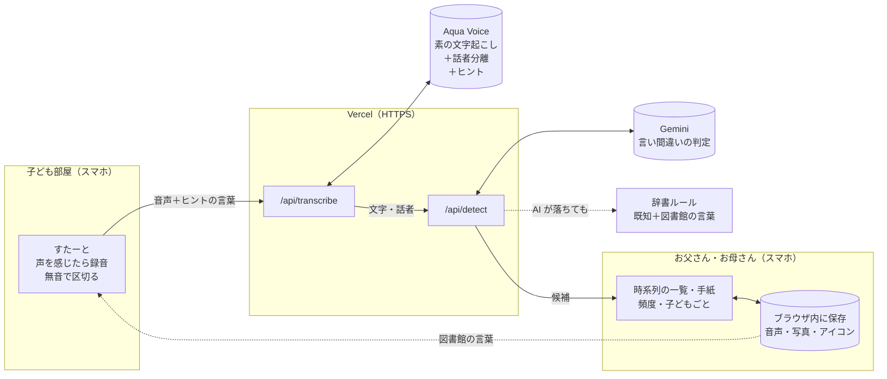

# 要件と設計: 言い間違い図書館

2026-11-23 作成、15:00 提出前の実装に合わせて更新。方針は MISSIONS.md の「方針転換」「作品の名前・UX・記事の方針」と JOURNEY.md に従う。公開先: https://iimachigai-library.vercel.app/

## 1. 誰の・どんな場面の面倒か
子どもの言い間違いは、気づかないうちに「卒業」してしまう。お父さん・お母さんが手を止めずに、声のまま残して、あとで楽に振り返れるようにする。

- 利用者: 仕事と家事に追われて、日々に忙殺されているお父さん・お母さん
- 痛み: 気づいたときには言わなくなっていて、何を言い間違えていたかも思い出せない。卒業の日はいつ来るか分からないので、手動の記録では間に合わない。書き留めても、あとで振り返るのが大変
- 主役は1つだけ: 言い間違いを残す。ケンカの仲裁は捨てて、展望に回した

## 2. 要件
### 作ったもの（15:00 の時点）
1. 子どもの声を録音し、Aqua Voice の**素の文字起こし**にする（話者分離つき）
2. 文字起こしから「言い間違い」を取り出す（AI ＋ 辞書ルール）
3. 見つけた言い間違いを、**確認なしで自動で**図書館に並べる
4. **音声クリップ付き**で時系列（新しい順）に並べる。頻度・子どもごとが分かる
5. **あとから人が決める**: 誰が言ったか／正しい言葉（訂正）／卒業した日／写真／図書館から外す
6. 外部 API が不調でも止まらない（辞書ルールのフォールバック）
7. **家族の言い間違いを覚える**: 図書館に入った言葉を、次の録音のヒントにする（第5節）
8. スマホ前提の2画面。子ども側は「すたーと」「おわり」だけ（全部ひらがな）。こまったときの「でんわ」ボタン

### やらない
- ケンカの仲裁（展望）／常時録音の本格運用／2台の端末にまたがる共有

## 2.1 「人が確認して決める」の見せ方
議論の結果、確認ボタンで止めずに**自動で所蔵**する。人が決める場面は、あとで振り返るときに残す（審査の⑤「人が確認して決める UI」のため、デモでは次を見せる）。
- 声のクリップを聞き返して、本当の発音を確かめる
- 「だれ?」で誰が言ったかを選ぶ（話者ラベルは録音ごとの番号なので、人が割り当てる）
- 訂正・卒業日・写真・図書館から外す

## 3. アーキテクチャ（部品は4つ）
| 部品 | 役割 | 置き場所 |
| --- | --- | --- |
| room 画面（子ども側） | マイク許可、声検出（VAD）で区切って録音、サーバーへ送る | `room.html` |
| museum 画面（お父さん・お母さん側） | 時系列の一覧、手紙、詳細、子どもの情報 | `museum.html`、`ui.css` |
| サーバー関数 | 文字起こしと言い間違いの判定 | `api/transcribe.js`、`api/detect.js`（Vercel） |
| 外部 API | Aqua Voice（文字起こし・話者分離）、Gemini（判定） | — |

マイクは HTTPS でしか使えないので、Vercel にデプロイして HTTPS にする。GitHub に push すると、Vercel が自動で公開する（確認では10〜30秒）。`/` は `/museum.html` に移る（`vercel.json`）。



## 4. 処理の流れ（ロジック）
```
room: 声検出 → 無音で区切る → 音声クリップ（webm / m4a）
  ↓ POST /api/transcribe（ヘッダー x-hint-words: 図書館の言葉）
Aqua: audio/transcriptions（素の文字起こし・avalon-2・language=ja・diarize=true・prompt=ヒント）
  ↓ { text, segments[{speaker, text, start, end}] }
POST /api/detect（museum: 図書館の言葉も送る）
  ├ 辞書: 既知の言い間違い ＋ 図書館に入った言葉（卒業した言葉は除く）
  ├ Gemini: 文脈から {wrong, right, note} を返す
  └ 話者ラベルを、それぞれの候補に付ける
  ↓
図書館に自動で保存（音声つき・ブラウザ内）。子どもが1人なら、その子の言葉に。複数なら「だれ?」
  → museum: 時系列の一覧・手紙・詳細 → 人があとで決める
```

Aqua が受け付けないとき（400/422）は、エラーが指す項目（prompt → diarize）だけを外して送り直す。音声そのものが読めないときは、1回で止めて 422 を返す。

### 主な関数（`lib/mistakes.js`。純粋な関数。`test/mistakes.test.js` で35件）
| 関数 | 役割 |
| --- | --- |
| `normalizeTranscript` | Aqua の応答（`turns` など）を `{text, segments}` にそろえる |
| `detectByRules` / `detectMistakes` | 辞書ルール／AI を試し、失敗したらルールで続ける |
| `familyDictionary` / `hintPrompt` | 図書館の言葉を、辞書とヒントの文にする |
| `attributeSpeakers` | 言い間違いに、言った話者のラベルを付ける |
| `recordSighting` / `frequencyOf` / `nthSighting` | 1回聞いた記録、頻度（通算・直近7日・1週間あたり・日別）、「N回目」 |
| `assignChild` | 誰が言ったかを変える（同じ録音の同じ声は、まとめて動く） |
| `addChild` / `updateChild` / `ageText` | 子どもの情報（最大6人。名前・誕生日・アイコン）、「3歳4か月」 |
| `updateEntry` / `graduate` / `removeEntry` | 訂正・卒業日・写真、卒業、図書館から外す |
| `unreadSince` | 前回「よんだよ」を押したあとに届いた記録（手紙） |
| `telHref` | 電話番号を `tel:` リンクにする（子ども側の「でんわ」） |

AI の呼び出しは `lib/gemini.js`（本番は Gemini）。`lib/openrouter.js` も切り替えられるが、動かして確かめたのは Gemini だけ。

## 5. 家族の言い間違いを覚える（ヒントの仕組み）
Aqua は、**知らない言い間違いを、実在する言葉に直す**。そのままだと、言い間違いは文字にした瞬間に消える。

- 本物の子どもの声で測ると、「さんとさん」は、ヒントなしだと「ほんとさ」になった
- 図書館に入った言葉を `prompt` で渡すと、「さんとさん」と聞こえたまま出た。「てびり」も同様
- ヒントだけでは直る言葉もある（「とうもころし」は、ヒントがあっても「とうもろこし」に直された）
- Gemini も、「さんとさん」を言い間違いと気づかない。そこで、図書館の言葉を**判定の辞書にも足す**
- 1回目は、おうちのひとが手で登録する必要がある（画面のボタンは外したが、登録の仕組みはコードに残している）。次からはヒントになる

## 6. 画面と世界観
「愛おしい・図書館・絵本・自然」。チームが作った「ことばとり」の水彩スプライトを使い、紙と鉛筆の記録帳にした。
- 言い間違いは、言った回数で育つ: たまご（1回）→ ふ化（2〜3回）→ ことばとり（4回〜）→ 卒業（虹色の羽で飛び立つ）
- 一覧の左に木の物差し。日付と曜日は、物差しの右横に鉛筆で書いたように置き、曜日の横に色鉛筆の絵
- 新着は、ことばとりが手紙を運んでくる。押すと便箋で、前回「よんだよ」を押したあとの分がまとめて読める
- 子ども側は、眠るとり（待機）→ 起きて歌うとり（スタート中）。表示は全部ひらがな
- ロゴは「いいまちがい としょかん」。「ち」を鏡文字にして、名前まで言い間違えている表現にした
- 子どもごとに、名前・誕生日・アイコン画像を登録。その子の色の色鉛筆で言葉を書く

## 7. データ（ブラウザ内）
| 置き場 | 中身 |
| --- | --- |
| `localStorage` `km.museum` | 図書館のカード（子どもごと・言葉ごと）。訂正・写真・卒業日 |
| `km.events` | 聞いた記録（いつ・何を・誰が・音声クリップの id） |
| `km.children` | 子どもの情報（名前・誕生日・色・アイコン画像の id） |
| `km.lastSeen` | 前回、手紙を読んだ時刻 |
| `km.tel` | おうちのひとの電話番号（子ども側の「でんわ」用） |
| `km.seeded` | サンプルを入れたことの目印 |
| IndexedDB `km` | 音声クリップ・写真・アイコン画像 |

正は `lib/mistakes.js` と `lib/store.js`。サーバーには、音声も写真も保存しない。
注意: 文字起こしのために音声は Aqua Voice に、判定のために文字は AI に送られる。「外部に出さない」とは言わない。

### 最初から入っているサンプル
はじめて開いたとき、記録が空なら、次が入る。
- ゆい・そら: 行だけ（声なし）
- たろう: **本物の声4本**（さんとさん・とうもころし・て てびり・てびり あとでみたい）。`assets/samples/`。リポジトリは公開なので、公開してよいことを本人に確認してから追加した

## 8. 環境変数（Vercel の Environment Variables）
- `AQUA_API_KEY`（Aqua Voice。scope は `transcription`）
- `GEMINI_API_KEY`（Gemini。未設定でも辞書ルールで動く）
- `OPENROUTER_API_KEY`・`OPENROUTER_MODEL`（任意）
- キーはコードにもログにも書かない。変えたら Redeploy が必要。確認: `/api/transcribe` が `aquaConfigured: true`、`/api/detect` が `llm: "gemini"`

## 9. リスクと、測って分かったこと
| リスク | 結果・対策 |
| --- | --- |
| **Aqua が言い間違いを正しい言葉に直す** | 読み上げ音声: 「てびり→手びり」と直されずに出たが、5回中2回は「手振り」に。本物の声: 「さんとさん→ほんとさ」「て てびり→テレビ」。対策: **音声クリップを残す**、**図書館の言葉をヒントにする**（第5節）。ヒントでも直る言葉がある |
| `diarize` が同期 API で使えるか | **使えた**。話者ラベルは録音ごとの番号。読み上げ音声2人は、どちらも同じ話者になった。本物の2人以上では**未検証** |
| 子どもの高い声 | 本物の声4本（1人）は文字にできた。**一般化はしない** |
| 実機のスマホの録音 | **未検証**（HTTPS が必要。公開先で試せる） |
| 会場の通信が不調 | 辞書ルールでフォールバック |

## 10. 既存コードとの関係
- `index.html` / `api/analyze.js`（仲裁中心の旧デモ「みまもりママコーチ」・Gemini）は、今日は使わない。消さずに残している（`/index.html` で開ける）。
- `server.mjs` は、ローカル確認用。`/api/transcribe` と `/api/detect` も動かし、`/` は図書館に移る（Vercel と同じ）。

## 11. 未確認・残っていること
- 実機のスマホのマイクで、「すたーと」から録音する流れ
- 本物の子ども2人以上の話者分離
- 写真・アイコンのファイル選択の操作（スマホ）、電話ボタンで電話アプリが開くか
- 2台の端末にまたがる共有（子どもの端末とお父さん・お母さんの端末を分ける）
